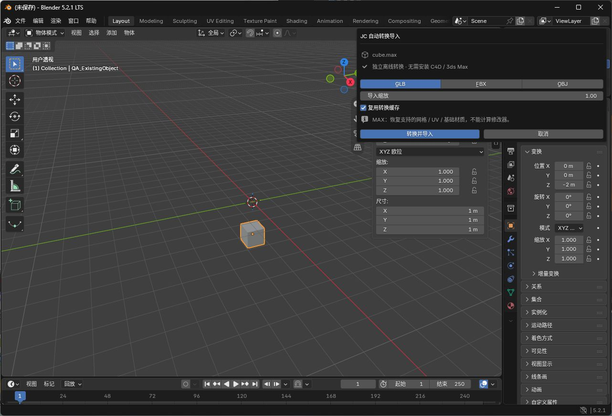

# JC 自动转换导入 1.0.5

Windows x64 / Blender 5.2.1 LTS 实测。面向 Blender 4.2 及更新版本构建，其他版本尚未逐版验证。

**无需安装 Cinema 4D、3ds Max、Assimp 或 Python。** 安装包包含独立转换组件；转换完全在本机运行，不上传模型、不使用在线接口、不修改源文件。

## 使用

1. 安装 `JC-Auto-Import-1.0.5-Windows.zip`：编辑 → 偏好设置 → 插件 → 从磁盘安装，然后启用。
2. 将需要转换的文件拖入三维视图，插件注册的原生文件处理器会打开格式选择弹窗。也可以使用 **文件 → 导入 → JC 自动转换导入**，或在右侧 **JC → 自动转换导入** 选择文件。
3. 选择 **GLB / FBX / OBJ**，点击 **转换并导入**。文件选择器支持多选，按顺序处理。
4. 后台转换期间可继续查看场景，在 JC 面板或按 Esc 取消。最终写入当前场景时由 Blender 原生导入器处理，复杂模型的导入阶段仍可能短暂占用界面。
5. JC 面板可以打开转换后的文件夹或日志。转换缓存长期保留；GLB / FBX 尽量打包纹理，OBJ 同时保留 MTL / 纹理文件。请整体复制输出文件夹。

原本已有 Blender 原生拖放入口的 OBJ、FBX、GLB 等格式不抢占其拖放处理；需要重新转换这些文件时使用本插件的文件选择入口。安装其他同格式导入器时，Blender 可能先出现处理器选择菜单。



## 格式能力

这里的目标是覆盖 C4D / 3ds Max 工作流中的多种格式，**不是仿真两款软件，也不等同于完整支持它们支持的全部格式**。

| 来源 | 独立读取路径 | 主要限制 |
| --- | --- | --- |
| `.max` | 内置 Autodesk MAX Importer 1.9.2 | 部分网格、基本体、材质、UV、层级；不执行修改器、脚本或第三方插件。压缩文件受上游版本限制，不能保证读取所有 MAX 版本。 |
| `.c4d` | 内置 Assimp + Cineware S22.008 独立组件 | 读取可识别网格及已保存的多边形 / 变形缓存；不能计算 MoGraph、生成器、第三方渲染器；新版本文件及缓存缺失时可能无法恢复。 |
| `.stp` / `.step` | 独立 Open CASCADE 7.9.3 + OCP 内核 | 实体与曲面网格化、可恢复的装配、颜色与单位；输出为静态网格。复杂破损曲面、外部文件引用和 PMI 未做完整保真保证。 |
| `.3ds` | 内置静态网格读取器 | 网格、UV、基础颜色 / 纹理、物体变换；不保留动画、关键帧层级、摄像机、灯光。 |
| DAE、DXF、LWO、3MF、OFF 等 | 内置 Assimp 6.0.5 | 格式版本、材质和动画支持程度取决于读取器。DXF 主要针对可恢复的三维网格；不保证二维图纸的完整转换。 |
| OBJ、FBX、GLB、glTF、STL、PLY、USD、ABC | Blender 自带读取器，再导出所选格式 | 取决于该 Blender 构建所包含的导入器。 |
| DWG、SKP、IGES、SAT 等 | 没有相应读取器时明确拒绝 | 不会转而要求安装原软件，也不会假装已经转换。STP / STEP 已单独接入 CAD 内核，不走 Assimp IFC 读取器。 |

完整的**引擎声明**扩展名位于 `jc_auto_import/capabilities.json`。声明不代表每一版本或每个模型都实测成功。独立导入不能保证原渲染器材质、绑定、动画与程序化效果的完整还原。

## 1.0.4 STEP 异常面恢复

- 对整体网格化失败的个别面，在独立几何副本上重新网格化，再将局部三角网格附回原面，保留原装配位置，不改写源 STEP。
- 对仍然失败的平面，按 0.005 毫米误差采样边界、投影到原平面并重建网格。只允许移除面积不超过 0.0001 平方毫米、跨度不超过 0.5 毫米的微小自交环；大自交拒绝恢复。重建面需通过有效性检查，面积变化不超过 max(0.001 平方毫米, 原面积的 0.2%)，网格节点不得超出原面边界 0.05 毫米。
- 仍无法恢复的面继续报错，不通过删除整面或整个零件冒充转换成功。发生恢复时，转换日志明确提示近似恢复。
- 两份实际 STEP 模型已完成 GLB / FBX / OBJ 转换和再导入：含面零件数分别为 44 和 41，未网格化面为 0，三种格式的零件数与三角面数一致；源 CAD 到网格的整体边界最大差小于 0.016 毫米。检查了 Blender 实际窗口及渲染结果。每份源文件各有 3 个不含面的节点，不属于可恢复的曲面网格。

该修复属于受误差约束的网格近似，不是 CAD 无损修复，也不代表任意破损 STEP 都可恢复。用户模型和图片不包含在 GitHub 或插件安装包中。

## 1.0.3 STEP 修复

- 修正 `.stp/.step` 误路由到 Assimp IFC 建筑模型读取器的问题，改用独立 CAD 内核处理常见 STEP 实体与曲面。自带便携运行时，无需安装原软件、FreeCAD 或 Python，无需联网下载组件。
- 保留可恢复装配层级、重复实例位置、基础颜色和 STEP 声明的尺寸单位，曲面转换为网格。默认弦高误差 0.05 毫米、角度误差 0.3 弧度；GLB / FBX / OBJ 均可输出。
- 若已传输的曲面有面无法生成网格则返回失败，避免静默丢失外壳。坏文件不写入成功缓存，旧版本缓存自动失效。
- STEP 带孔实体、圆柱曲面、重复装配实例样例已在 Blender 5.2.2 LTS / Windows 完成三种输出再导入，核对数量、尺寸、位置、体积及颜色。尚未获得本次用户失败 STP 的路径，因此不能将样例结果当作该文件通过。

安装包因包含 CAD 内核增大。转换后是网格，不能保留 CAD 参数历史；外部文件引用、PMI、异常实体和大装配的完整恢复未逐项验证。

## 1.0.2 修复

- C4D 按**编辑器可见状态**转换：读取物体隐藏点、父级继承、图层可见开关及隐藏面。不会把隐藏的备用件重新显示；渲染隐藏和编辑器隐藏不一致时，以编辑器为准。显式开启的子级仍可显示。
- 修正 C4D 左右手坐标转换：同时处理几何、局部矩阵、法线与面朝向，不再通过整个根节点的负缩放传递镜像；保留层级与零件位置。
- 没有多边形缓存的普通实例可展开其引用网格或组，避免直接漏掉实例；不会附带引用源的兄弟对象，也不会重复加上引用源的位置。缺失/循环引用及无缓存的多重实例仍会在引擎日志中提示限制。
- 新版本和引擎哈希使旧缓存自动失效；无需手动删除缓存。

同名或相同形状的可见零件不会被自动去重。图层 Solo、Take、MoGraph、多重实例及渲染器覆盖的完整效果不在本次保真验证范围内。

## 1.0.1 修复

- 修复独立引擎在 Windows 下错误解码中文、非 ASCII 及 emoji 路径而返回代码 10 的问题。输入文件、输出缓存及工作目录均使用 Unicode 路径回归检查。
- 代码 10 现在显示源文件读取失败的具体原因；不再对读取失败的输入重复尝试 OBJ。其他不兼容文件仍可能读取失败，这不等于所有代码 10 都属于路径问题。

某些动画 / 骨骼结构无法通过 Assimp 的 GLB 中间导出器时，插件会尝试通过 OBJ 恢复静态几何体，并在日志中明确告知动画 / 骨骼没有保留。找不到任何可恢复网格时返回失败，不创建虚假的成功结果。

## 实测与验证边界

- Blender 5.2.1 LTS / Windows：真实 MAX `RotatingCube.max`、Cineware SDK `cube.c4d`、3DS 网格及三种输出格式，均完成转换后再次导入，检查到实际网格。
- 原生 UI 弹窗、点击确认、MAX 后台转换与当前场景导入已在实际窗口检查。
- 10 项自动化测试覆盖几何 / UV / 材质、中文与 emoji 输入输出路径、GLB / FBX / OBJ 输出、缓存复用、相邻资产变更、坏文件拒绝、具体错误原因、避免无效重试、源文件保持不变及取消独立进程。
- 自建 C4D 回归场景经 GLB / FBX / OBJ 再导入检查隐藏继承、可见子级、隐藏图层、隐藏面、同名不同位置零件、非均匀缩放和实例位置。真实鼠标场景另做零件及渲染对比。
- 更多样例与 UI 核查结果见 `VALIDATION.md`。小样例耗时不能代表大场景速度；未在第二台电脑验证。

## 构建

```powershell
python build.py
python tests/test_conversion.py --blender D:\Blender\blender.exe -v
```

`build.py` 使用明确的文件清单生成扩展 ZIP，不包含场景、用户设置、模型原文件、缓存、登录数据或 SDK 源包。

独立转换组件构建见 `engine/README.md`。用户安装和使用本插件无需开发工具或 SDK。插件 Python 代码为 GPL-3.0-or-later；单独进程运行的转换组件包含 BSD 授权 Assimp 和 Maxon Cineware 组件，详见随包许可与第三方说明。

## 1.0.5 大型模型转换时限

Windows / macOS 默认不限转换总时长，不因超过 5 分钟或长时间没有日志而中止。Esc 可取消。偏好设置可主动开启单文件总时限（最长 7 天），各转换阶段及备用转换共享同一预算。旧版保存的 300 秒在未开启新开关时不生效。
