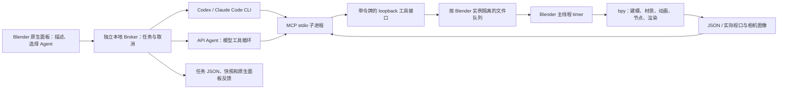

# 架构与开发

## 完整调用链



本版没有依赖第三方 Blender-MCP 服务包；MCP 是协议，`blender-mcp` 是其中一个社区实现。本版独立实现专用的 stdio 服务，避免把用户已有 AI 客户端、视频中用到的客户端版本和插件依赖锁在一起。没有复制社区项目代码。

## 模块

- `addon/jc_blender_agent/__init__.py`：原生面板、偏好设置、主线程命令执行、快照、实际截图和渲染。
- `bridge/broker.py`：独立进程 HTTP 服务、任务生命周期、实例互斥和文件队列。
- `bridge/mcp_server.py`：JSON-RPC 2.0 / MCP stdio 服务，7 个工具，image 内容块。
- `bridge/agents.py`：本地 Codex / Claude CLI、API 工具循环、MCP 客户端与进程取消。
- `bridge/common.py`：原子 JSON、Windows 短暂文件共享冲突重试、本地鉴权请求。

Blender 自带 Python 不适合挂长期 Python 后台线程。网络、Agent 和 MCP 均在外部进程运行；Blender 每 250 ms 检查本实例 inbox，每次最多消费一条命令。`.json → .running → .done` 标记让进程崩溃后也不会自动重放已开始的修改。

## MCP 范围

实现 stdio newline-delimited JSON-RPC：initialize、initialized、ping、tools/list、tools/call。支持客户端请求的已知协议版本并提供工具能力；未知版本返回支持版本供客户端判断。不声明 resources/prompts 功能，返回空列表用于兼容。提供输入类型、必填项和范围校验；工具失败用 `isError=true`，协议失败用 JSON-RPC error。

不是通用 MCP 托管平台：不提供 HTTP MCP transport、OAuth、远程多用户服务器、任务协议扩展或 HTTP 会话恢复。当前外部接入走 stdio MCP，本地 HTTP 仅是内部桥接协议。

## 本地服务接口

所有接口验证 `Authorization: Bearer <local-token>`，不提供 CORS。

| 路径 | 作用 |
|---|---|
| GET `/health` | 服务状态、活跃 Blender 实例、本地 CLI 发现结果 |
| POST `/jobs` | 提交描述、Agent 配置和 Blender 上下文，立即返回任务 ID |
| GET `/jobs/<id>` | 读取任务与工具事件；服务重启后旧 running 任务视为 interrupted |
| POST `/cancel` | 停止 Agent 后续调用，并标记队列请求取消 |
| POST `/tools/call` | MCP 服务内部工具转发；按实例加锁 |

API Key 只通过 loopback 的任务请求进入 Broker 内存，不进入 MCP 配置、磁盘任务记录或 CLI 参数。API 配置的网关只接收用户描述、所需场景信息和被工具请求的图像；不会自动上传整个 .blend。

## 外部客户端配置

插件面板可复制当前实例的 JSON。其他机器/实例不能直接复用它。

```json
{
  "mcpServers": {
    "jc_blender": {
      "command": "C:/path/to/python.exe",
      "args": [
        "F:/BlenderAgentBridge/bridge/mcp_server.py",
        "--state", "C:/Users/your-user/AppData/Local/JCBlenderAgent",
        "--instance", "32位当前实例ID"
      ]
    }
  }
}
```

Codex TOML 示例（外部客户端手动配置；插件内置 Codex 路径不需要此步骤）：

```toml
[mcp_servers.jc_blender]
command = 'C:\path\to\python.exe'
args = ['F:\BlenderAgentBridge\bridge\mcp_server.py', '--state', 'C:\Users\your-user\AppData\Local\JCBlenderAgent', '--instance', '32位当前实例ID']
tool_timeout_sec = 620
default_tools_approval_mode = "approve"
```

`approve` 只针对这个服务。用户应理解 execute 允许执行本机 Python，然后按自己的外部客户端授权偏好决定工具策略。插件内任务保持 shell read-only，MCP 只用当前实例路由。Codex 的模型与审批键已对照 [OpenAI 官方 MCP 文档](https://learn.chatgpt.com/docs/extend/mcp?surface=cli) 和本机 CLI `--help` 核对。

## 调试与扩展

```powershell
python -m bridge.broker
& D:\Blender\blender.exe --background --factory-startup --python F:\BlenderAgentBridge\tests\blender_background.py
python F:\BlenderAgentBridge\tests\test_bridge.py
python F:\BlenderAgentBridge\build_release.py
```

测试使用独立 `JC_BLENDER_STATE`。添加 Agent 应放在 `agents.py`，统一返回最终文字、支持 cancel，并经相同 MCP 工具链执行。添加专用工具应同时更新 MCP schema、addon 执行器和协议测试，避免两条后端生成不同的控制语义。

可继续扩展的方向：可持久化多 API 配置档、逐工具人工审阅模式、工具调用预算、多角度自动验收、节点参数专用工具、大型任务分阶段计划、物理模拟缓存和长渲染的异步管理。它们不作为 0.1.0 已完成功能。
